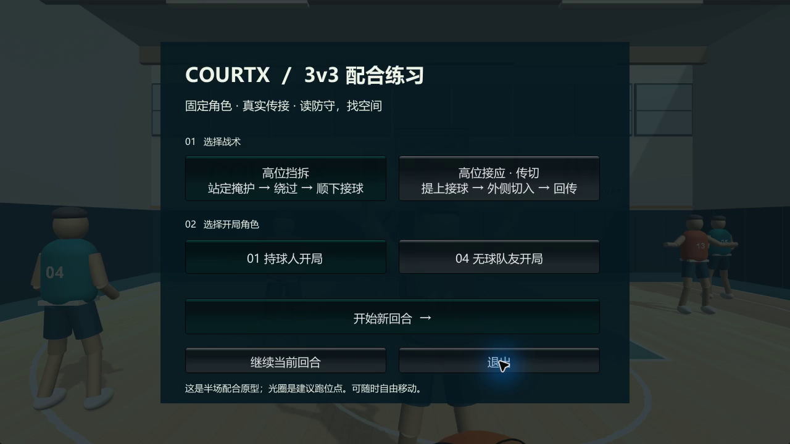
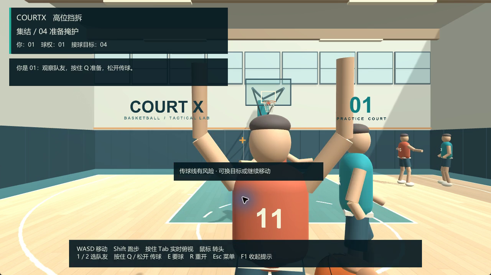
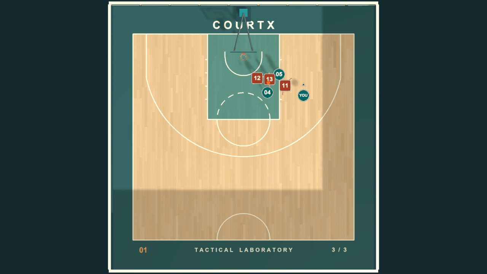

# 3v3 tactical iteration — 2026-11-07

## Delivered behavior

Two drills, each with handler / off-ball starts: high pick-and-roll and high-post reception with pass-and-cut. The human keeps one identity while ownership moves among teammates. Five NPCs space, screen, roll, cut, slide, raise their arms, hedge and recover. Passes have visible flight and actual receiving; defensive lanes can deny a request or intercept a forced pass. A moving human can also miss the fixed catch point.

The original practice remains in `Windows/CourtX.exe`; the new program is `Windows_Tactics/CourtX Tactics.exe`. The original scene, prefab, runtime scripts and project settings were compared with `v0.1-free-practice` and have no source differences. The stable `main` / `v0.1-free-practice` source was uploaded before development began. Tactical development stays on `feature/tactical-training`.

## Iterations and evidence

Seven full tactical regression runs were performed, with actual Unity scene simulation and camera recording. Early recordings are retained locally rather than hidden by final success results.

| Run | Finding / result | Response |
| --- | --- | --- |
| Round 1 | 7 failed assertions; high-post passer remained behind a blocked lane, and premature passes were intercepted | Added lateral AI movement to seek a passing angle; player route reads the window before release |
| Round 2 | 3 failures, all from high-post handler entry | Matched release geometry to lane evaluation and included short-term defender motion |
| Round 3 | 2 failures in off-ball pick-and-roll: receiver remained behind the defender | Followed the actual denial feedback, moved to a new angle and requested again; all four ordinary routes then completed |
| Review regression, red | 4 failures: a ball-holding screener or abandoned screen could advance; an outside reception bypassed the high post; fast close passes skipped interception | Added ball/position/real-catch phase guards, recovery at the high post, and swept interception from the first flight frame |
| Review regression, green | 44 passing checks, no failures | Fresh independent reviewer confirmed the three findings were addressed |
| Feedback regression, red | 1 failure: a completed drill eventually displayed a waiting hint | Reproduced and guarded terminal-phase feedback |
| Final | **45 passing tactical checks, zero failures** | Final state and output saved in [tactics-final.txt](verification/tactics-final.txt) |

The unchanged free-practice scene also passed **28 checks**, including walking/running, moving during held Tab, release without teleport, ball charge, court collision, recall and reset. See [free-practice-regression.txt](verification/free-practice-regression.txt).

## Standalone review

The Windows build was launched and its Chinese menu and HUD inspected. Native app input verified: start a drill, select teammate with 2, release a Q pass (05 caught while the human remained 01), E denial feedback, Esc menu, change to high-post/off-ball, brief Shift+W movement, Tab release returning to first person, R retaining the off-ball start, and Alt+Tab automatically pausing. Sustained held-Tab movement and exact sprint distances are covered by the engine-driven tests, not claimed as long manual input measurements.

This review led to a dark background for the first-person pass hint, a narrow left sidebar in overview so instructions do not cover player positions, and removal of duplicate denial text. The new sidebar is a presentation change; player controls and scene geometry stay the same.

The first attempt to start through the computer-use tool timed out. Launching through the normal executable and then attaching to the returned window restored native app control. A GDI window-target recording captured a stale initial frame; it is retained only as `diagnostic-frozen-window-capture.mp4` and is **not** gameplay evidence. The four-mode engine recording is valid continuous simulation; desktop-region capture is used for the final interface recording.

## Local recordings

All paths below are relative to the CourtX folder, not remote downloads. Videos/builds are intentionally excluded from Git; text evidence and source are tracked.

- `Preview/Playtests/Tactics/CourtX-3v3-four-modes.mp4`: 32.6 seconds, 1280×720, 30 fps. Four complete normal routes with chapter labels, using the real scene and normal public input/ball interfaces. It is an automated route demonstration, not a human full-match recording. Direct camera capture omits the OnGUI HUD.
- `Preview/Playtests/Tactics/standalone-final-ui.mp4`: 45-second recording of the final standalone app's client region, including Chinese menu/HUD, target selection, short movement, Q passing, teammate reception and an E return pass. Its frame samples were visually inspected and the entire file decoded successfully. It is a native-input smoke test, not the four-drill completion test. Native Tab taps were too brief to obtain a clear overview frame; held-Tab behavior is verified by the engine-driven controls checks.
- `Preview/Playtests/Tactics/final.mp4`: 62.2-second final engine run, including the waiting-feedback check and clearly separate adversarial fixtures. Fixture positions are set deliberately for deterministic regression; they are not presented as natural play.
- `Preview/Playtests/Tactics/round1.mp4`, `round2.mp4`, `round3.mp4`: earlier iterations with matching checks and snapshots.
- Raw logs and the test harness remain available for reproduction. The final videos are checked with ffprobe and decoded end-to-end with FFmpeg.

## Limits

This is a bounded 3v3 training prototype, not complete 2–3 zone defense or a full basketball game. No shot scoring, rebounds, fouls, trained policy, production motion capture or multiplayer. A risky pass can fail; E requests cooperation rather than guaranteeing possession. An interrupted or off-script rep can be reset with R. See [integration details](tactical-integration.md) and [sources / licenses](tactical-sources.md).

## Captured views

